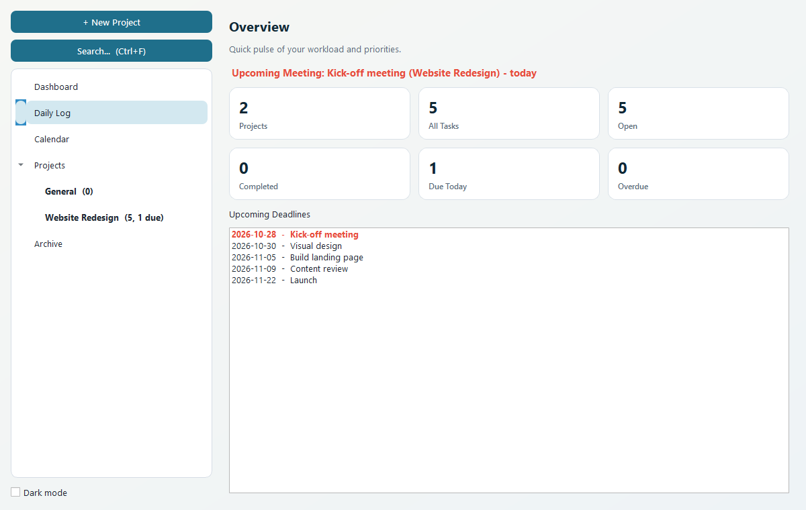
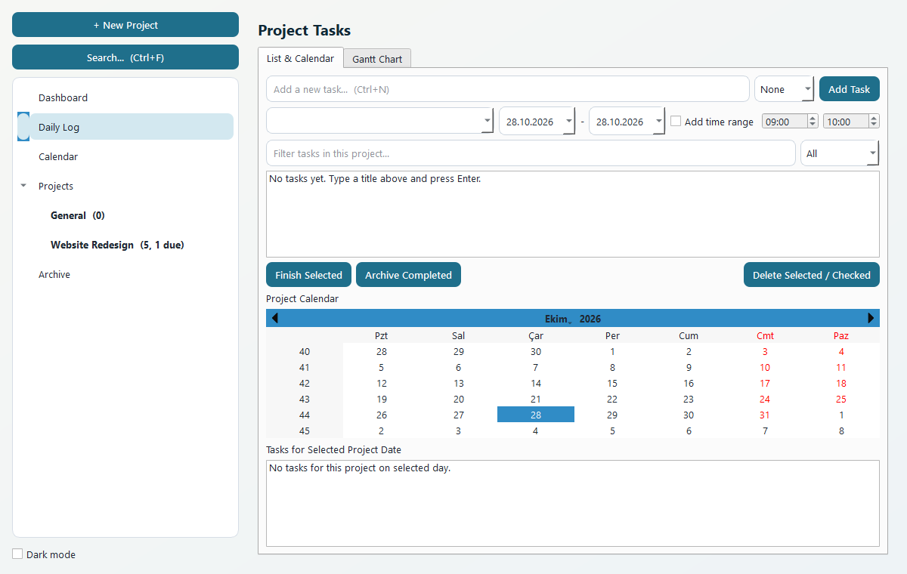
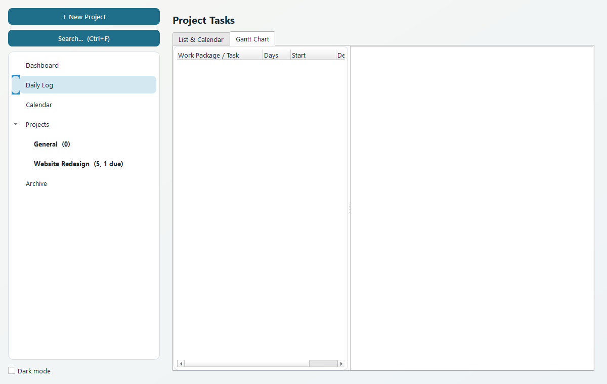
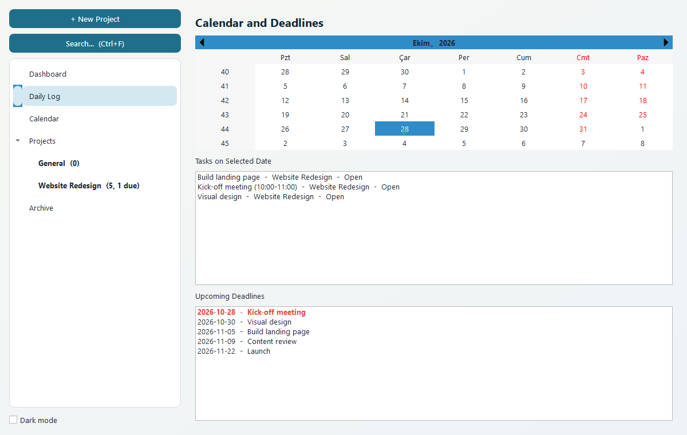
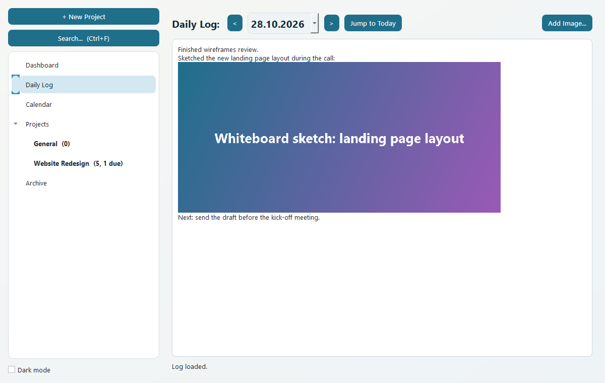
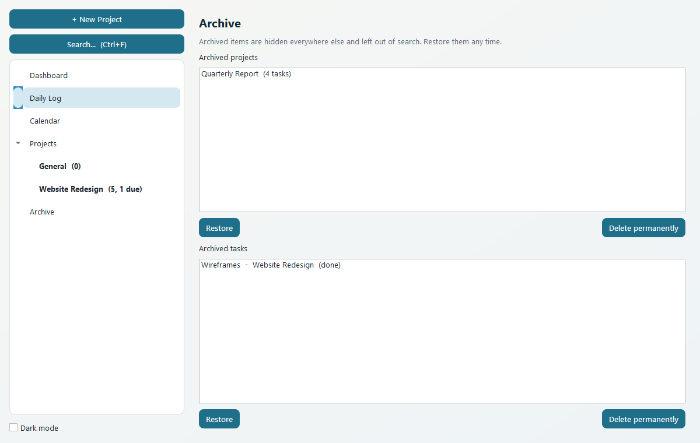
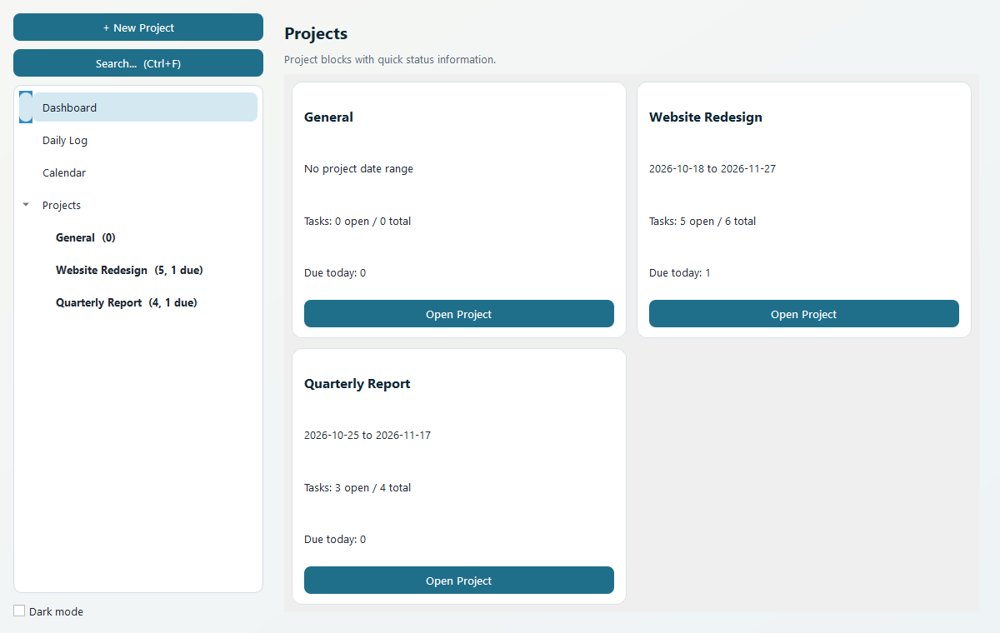
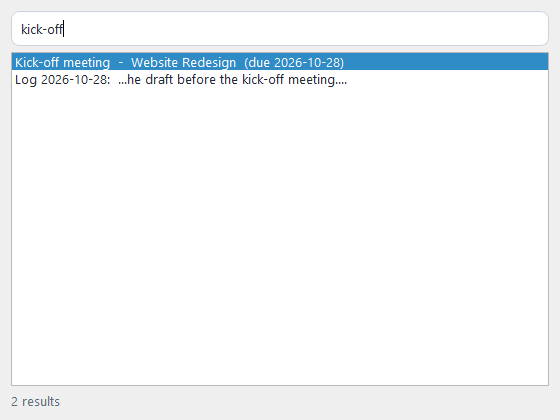
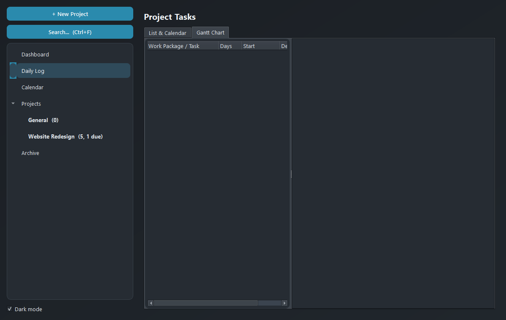

# Personal Work Schedule

A local-first desktop planner for organising work across several projects. It combines a task list, a calendar, a Gantt chart and a daily log in one window. Everything is stored in a single SQLite file on your machine, with no account, server or network access.

Built with Python, PySide6 (Qt) and SQLite.



## Features

- **Dashboard** – counts of projects, open, completed, due-today and overdue tasks, a banner for your next meeting, and a list of upcoming deadlines (due-today items in red).
- **Projects** – create projects with optional start/end dates, rename them, and drag them in the sidebar to reorder.
- **Tasks** – each task has a title, start date, deadline, optional start/end time, an optional *work package* used for grouping, a **priority** (None/Low/Medium/High) and free-text **notes**. Tasks can be checked off and can have a checklist. Press Enter in the title box to add a task, and use the *High Priority* filter to focus.
- **Gantt chart** – per-project timeline with tasks grouped by work package, a dashed **Today** line, and labels that move beside a bar when it is too small to hold them. Drag a bar to reschedule it. Tasks with the work package `Meeting` are treated as meetings and surfaced on the dashboard.
- **Calendar** – month view with markers on days that have tasks, plus the tasks for the selected day.
- **Daily log** – notes saved per day, with **images**: paste a screenshot (`Ctrl+V`), drag image files in, or use *Add Image...*. Images are copied into an `attachments/` folder next to the database.
- **Archive** – archive finished tasks (*Archive Completed*, or right-click a task) or whole projects (right-click in the sidebar). Archived items disappear from every view and from search, and can be restored or deleted permanently from the *Archive* page.
- **Global search** (`Ctrl+F`) – finds tasks (title, notes, work package, project) and daily logs, and jumps straight to the result.
- **Dark mode** – toggle in the sidebar; your choice and window size are remembered.
- **Reminders** – a popup on launch lists tasks due today.

## Screenshots

| Tasks | Gantt chart |
|---|---|
|  |  |

| Calendar | Daily log with an image |
|---|---|
|  |  |

| Archive | |
|---|---|
|  | |



| Search | Dark mode |
|---|---|
|  |  |

The screenshots use made-up sample data.

## Getting started

Requirements: Python 3.10+ and the packages in `requirements.txt`.

```bash
pip install -r requirements.txt
python main.py
```

### Keyboard shortcuts

| Shortcut | Action |
|---|---|
| `Ctrl+N` | Jump to a project and focus the new-task box |
| `Ctrl+F` | Search tasks, notes and daily logs |
| `Enter` (in the task box) | Add the task |

### Where is my data?

Your data lives in `planner.db`, in the same folder as `main.py` (or next to the `.exe` when running the packaged build). It is created automatically on first launch, and older databases are migrated in place when new columns are added.

To back up or move your schedule, copy `planner.db` **and the `attachments/` folder** (daily-log images) together. Both are excluded from git so personal data is never committed.

To use a different file (for example for testing, or a database on a synced drive), set the `PLANNER_DB` environment variable to its path before launching:

```bash
PLANNER_DB=/path/to/other.db python main.py
```

## Build a standalone executable (Windows)

```bash
pip install pyinstaller
pyinstaller --onefile --windowed --name PersonalWorkSchedule main.py
```

The executable is written to `dist/`. Place a `planner.db` next to it to bring existing data, otherwise a fresh one is created. If the build misses SQLite DLLs (common with Anaconda Python), add them with `--add-binary`.

## Development

```bash
pip install -r requirements.txt -r requirements-dev.txt
python -m pytest
```

The tests use a temporary database and render Qt offscreen, so they never touch your real `planner.db` and need no display. They run on every push via GitHub Actions.

## Project layout

| Path | Purpose |
|---|---|
| `main.py` | Main window, sidebar, project management, theme and application entry point |
| `database.py` | SQLite schema, migrations, queries and attachment storage |
| `views/` | One module per screen: `dashboard`, `tasks`, `gantt`, `calendar_view`, `calendar_widget`, `daily_log`, `archive`, `dialogs`, plus shared `theme` |
| `tests/` | pytest suite for the database layer and the UI |
| `docs/screenshots/` | Images used in this README |
